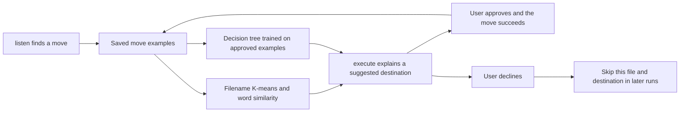

# Clean architecture

Clean is a C++23 command line utility. It keeps learning history under the directory where the user runs it. Premake builds the sources in `clean/src/` and the checked-in Visual Studio project lists the same CLI sources.

## Commands and ownership

| Component | Responsibility |
| --- | --- |
| `main.cpp` and `commands.cpp` | Dispatch commands, parse options, and report errors. |
| `SortCommand` | Groups files by the selected static sort options. It uses its own scan and file operations. |
| `KCluster` | Scans the working directory's subdirectories, detects changes, saves history, and writes both graphs. It also runs the approval prompts and applies moves. |
| `SuggestionModel` | Tokenizes filenames, fits the filename K-means model, trains the approval tree, and scores destinations. It does not read or move files. |

## Listening and activity graph

`listen` starts with a snapshot of regular files inside subdirectories. Each snapshot stores relative paths, sizes, and modification times. Clean skips files directly under the working directory, symlinks, and its state and Git directories.

A scan compares the current snapshot with the previous one to record additions, deletions, and modifications. A removed file and a new file can count as one move when their sizes, modification times, and extensions match, with a same-name check to resolve multiple candidates. A paired move between subdirectories adds a source and destination example.

`.clean/graph.svg` shows file activity. Its K-means inputs are a 16-slot extension bucket vector and one log-size feature. The SVG shows size horizontally and extension bucket vertically. The color marks the closest cluster. This graph keeps its original role as a view of filesystem changes.

## Suggesting moves

1. **Read the name.** Strip the final extension, fold ASCII letters to lowercase, and split the remaining name on whitespace, ASCII punctuation, and digits. Repeated words count once. For example, `Invoice.May,2026.PDF` yields the words `invoice` and `may` and the exact extension `.pdf`. Non-ASCII characters are kept as written.
2. **Fit filename K-means.** Each distinct word defines a dimension. A file's vector has equal, normalized weights for its words. The model picks distinct starting points, then repeatedly assigns examples to the nearest centroid and averages each cluster. It uses up to eight clusters, with the number of observed destinations and unique filename vectors setting the other bounds. The latest move from each source path contributes an example.
3. **Try the approval tree.** Train a binary tree on successful, explicitly approved moves. Each branch asks if the extension or source folder equals a value or if the name contains a word. The model chooses the split that best separates destinations by Gini impurity and stops at depth six. A leaf needs at least two approved examples with the same extension and similar names before it can supply a destination.
4. **Rank similar names.** If the tree has no supported destination, compare the file with examples of the same exact extension. Jaccard similarity divides the number of shared words by the total number of distinct words across both names. Similarity of at least 0.25 earns a vote. Cluster membership, source folder, and file size give smaller adjustments.
5. **Try the extension fallback.** When name votes are insufficient, count same-extension examples from the same source folder first. If that folder has fewer than two examples, count across folders. A conflicting filename clue blocks this fallback. Every route needs at least two examples for the destination and at least 75% of the vote weight.

`.clean/suggestions.svg` shows examples and proposals. Each row corresponds to a filename cluster. Horizontal position represents cosine similarity to that cluster's center. Green marks an approved example and amber marks a proposal presented or applied by the latest execution. A new listen scan redraws the graph from the examples.

## Feedback and local state

`execute` checks the suggested destination and skips files already there, previously declined file and destination pairs, and existing targets. A successful manual approval saves the example for future runs. A rejection saves the file and destination pair. Automatic moves contribute activity records and leave the approval tree and approval count alone.

`.clean/state.txt` is the source of truth. Models and graphs are rebuilt from this file rather than serialized separately.

| Record | Stores |
| --- | --- |
| Header | Format version and review counters |
| `S` | File snapshot entry |
| `C` | Recorded file change |
| `O` | Observed move example |
| `A` | Successful, explicitly approved move example |
| `R` | Declined file and destination pair |

Clean reads the original `CLEAN1` format and writes `CLEAN2`. The previous format did not mark individual approvals, so older move examples remain useful for filename matching and the saved counters carry over. Only the new `A` records train the tree. State and SVGs contain paths and metadata. The scanner never reads file contents. Stop the listener before running `execute` in the same directory so only one command writes its history.

The watcher polls snapshots. Brief changes that start and finish between scans may be missed. Filename matching uses exact words and does not infer synonyms or read document contents.
